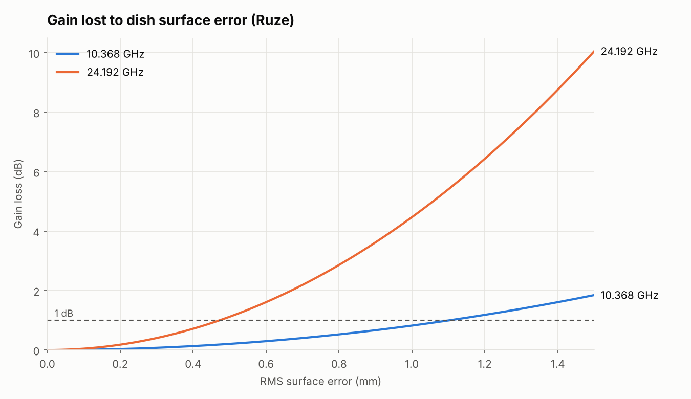
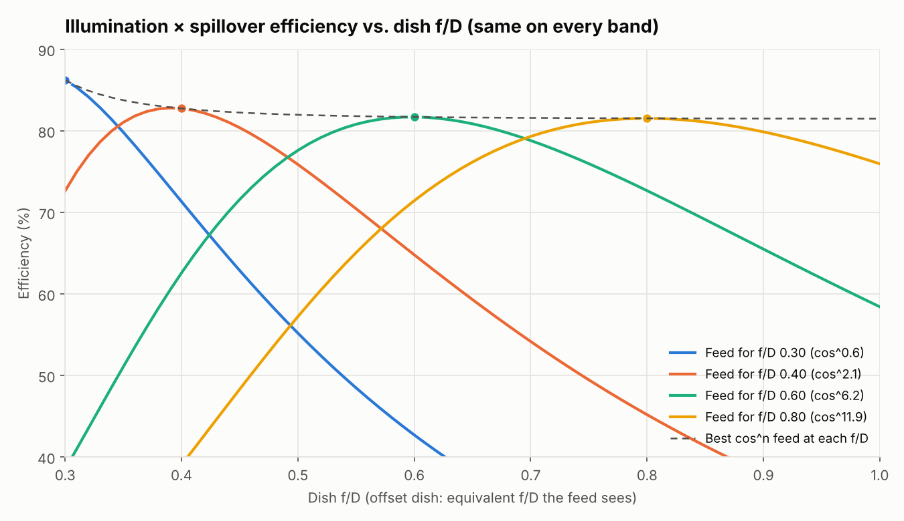
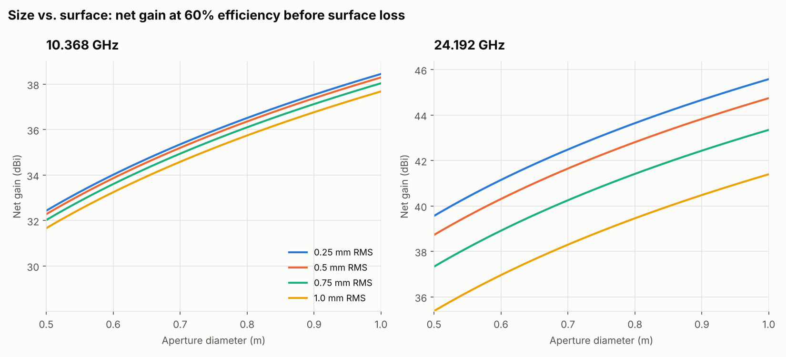
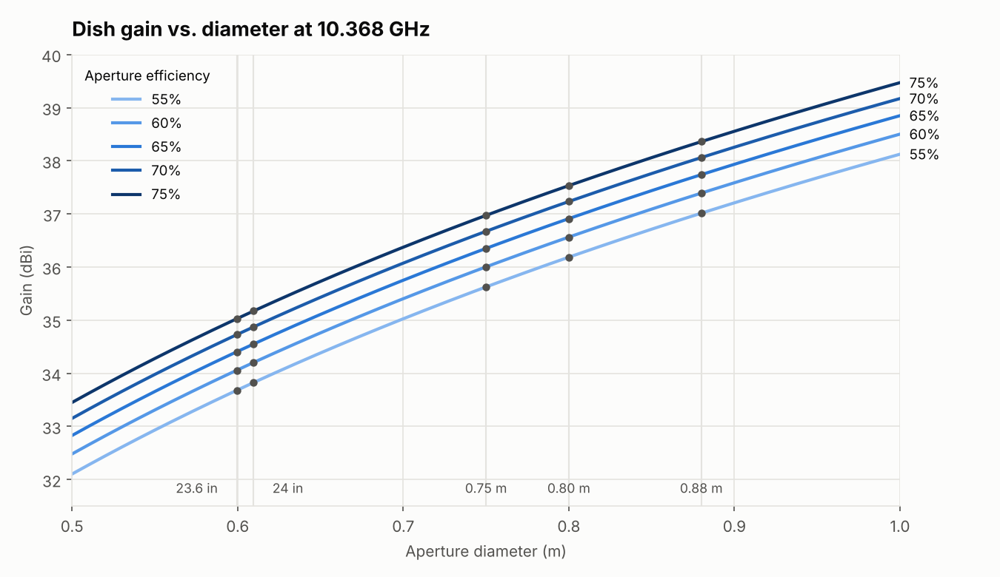
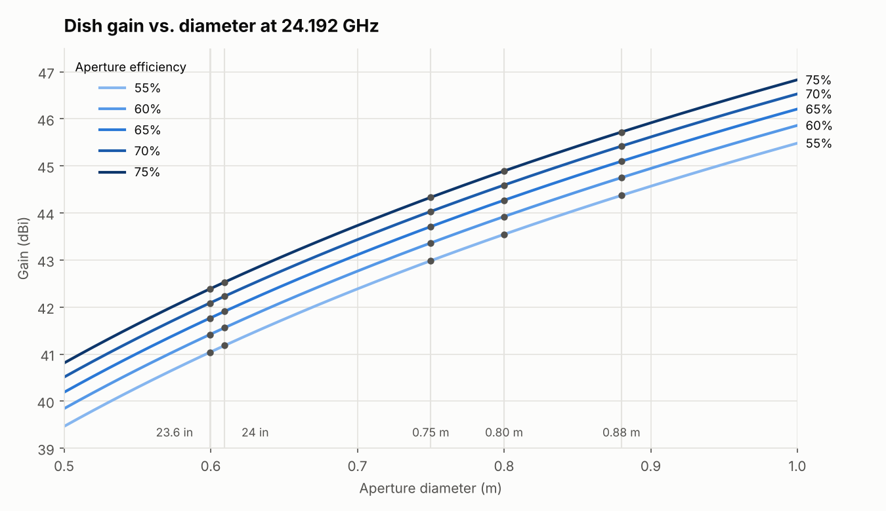
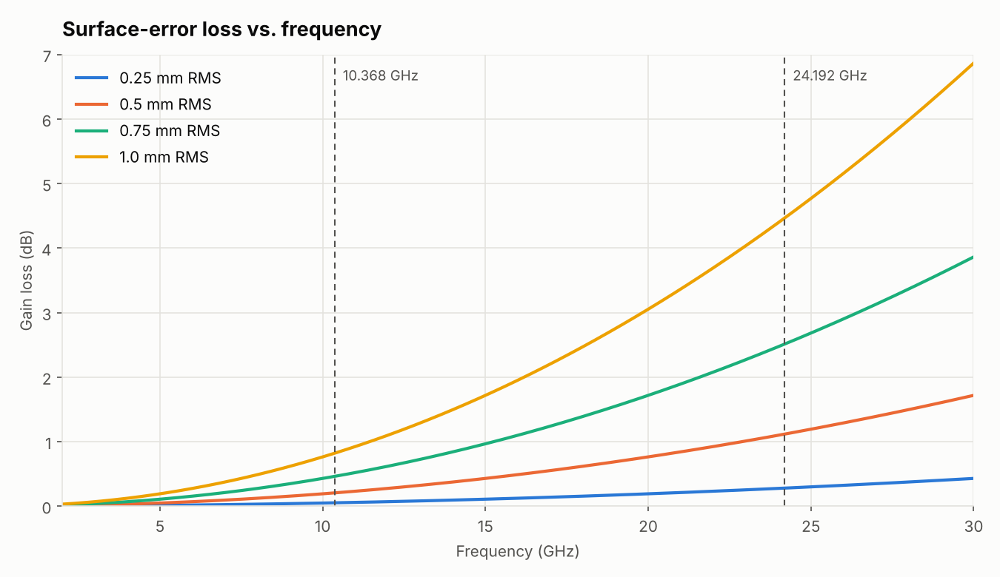
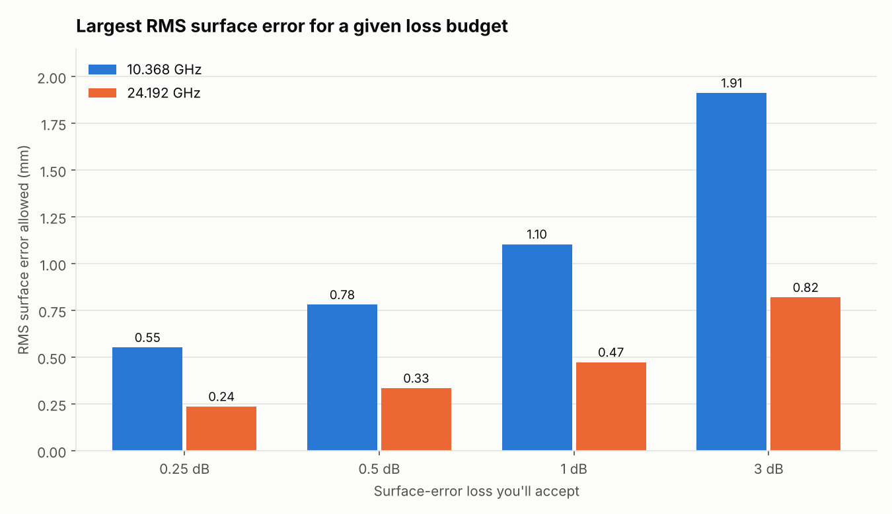
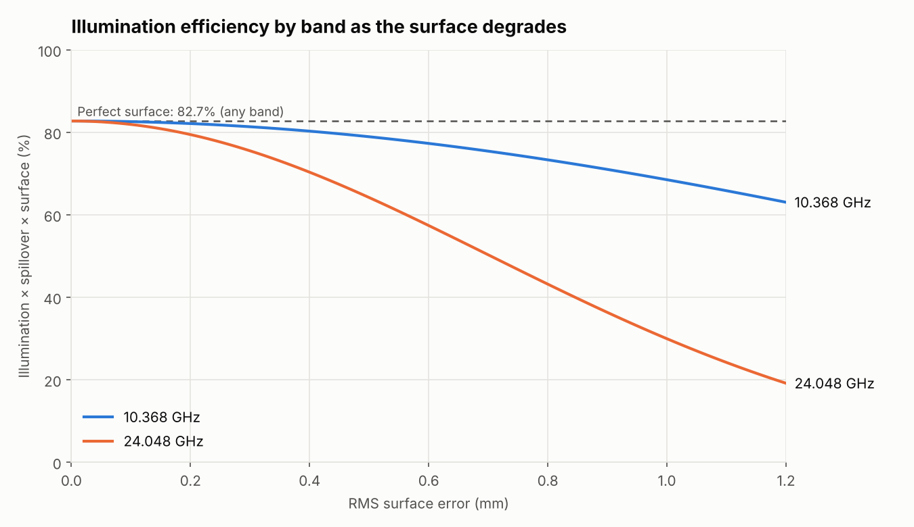
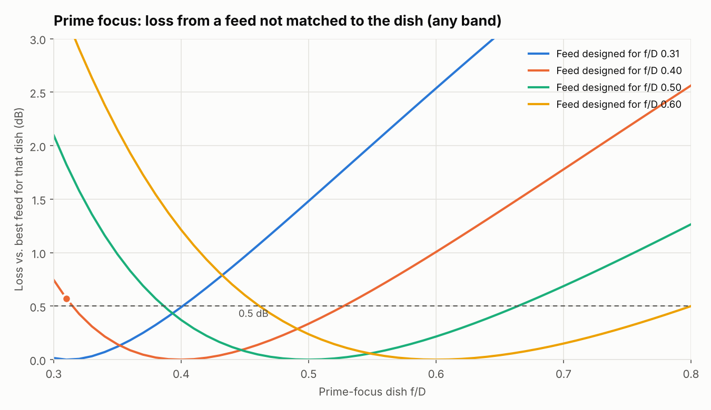
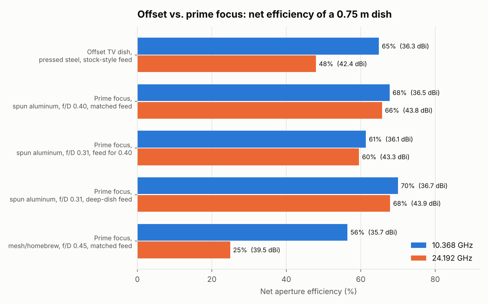

# Offset Microwave Dish Comparisons

[](https://github.com/rusk2ua/offset-microwave-dish-comparisons/actions/workflows/check.yml)

How much gain do common amateur microwave dishes (about 0.6–0.9 m) give on **10 GHz** and **24 GHz**? This repo answers that for surplus **offset** satellite-TV dishes and compares them with **prime-focus** dishes. It also shows what eats into the gain: aperture efficiency, feed illumination and blockage, and reflector surface accuracy.

It includes a small Python calculator (`dishcalc.py`), a script that regenerates every table and chart in this README (`make_report.py`), and tests that pin the results to known values.



## Key takeaways

- **The same dish gains 7.36 dB going from 10.368 to 24.192 GHz**, as long as its efficiency holds up.
- **Efficiency usually doesn't hold up at 24 GHz.** Surface-error loss grows with frequency squared, so a given surface costs about **5.4×** as many dB at 24 GHz as at 10 GHz. A pressed-steel dish with 0.5–0.8 mm RMS error barely notices it on 10 GHz (0.2–0.5 dB) but loses 1.1–2.9 dB on 24 GHz.
- **Illumination efficiency is pure geometry.** A feed scaled to each band gives the same illumination efficiency on 10 and 24 GHz. The difference between bands comes from the surface, not the feed.
- **Offset dishes are all alike in the ways that matter here.** They're built for satellite TV and use much the same feed geometry, so f/D isn't a useful way to compare them. What separates one from another is mainly size and surface accuracy.
- **Prime-focus dishes vary much more.** f/D, how well the feed matches it, and surface quality (spun aluminum vs. mesh or homebrew) all swing widely. That's where the f/D and feed analysis below matters.
- **Plan on 50–65% total aperture efficiency** for a real amateur dish. Figures of 70–75% describe illumination alone, before spillover, blockage, surface error and feed loss.
- **On a prime-focus dish, a mismatched feed costs a few tenths of a dB.** A feed designed for f/D 0.40 on an f/D 0.31 dish loses about 0.4–0.6 dB. Moving the feed doesn't fix it; a feed with a wider beam does.

## Quick start

```bash
pip install -r requirements.txt

# Gain, surface loss and beamwidth for a 76 cm dish on 10 and 24 GHz, 60% efficiency, 0.5 mm RMS
python dishcalc.py -d 76cm -f 10.368 24.192 -e 0.60 -r 0.5

# Add a feed-mismatch estimate
python dishcalc.py -d 24in -f 10.368 -e 0.65 --dish-fd 0.31 --feed-fd 0.40

# Regenerate README tables and images/
python make_report.py

# Run the tests
pytest
```

Diameters can be given as `0.8`, `0.8m`, `76cm`, `24in` or `24"`.

## The math

### Gain

$$G = \eta \left(\frac{\pi D}{\lambda}\right)^2 \qquad G_{dBi} = 10\log_{10} G$$

where η is the total aperture efficiency (a fraction), D is the aperture diameter and λ = c / f.

> **Common mistake:** writing it as `(η·π·D/λ)²` squares the efficiency. That understates gain by 10·log₁₀(1/η): 1.55 dB at 70% and 1.25 dB at 75%. The test `test_efficiency_not_squared` guards against it.

### Beamwidth

The half-power beamwidth is approximately **HPBW ≈ 70·λ / D** degrees. At 24 GHz these dishes are about 1° wide, so pointing and mount stiffness matter about 2.3× more than on 10 GHz.

### Surface error (Ruze)

$$L_{dB} = 4.343\left(\frac{4\pi\varepsilon}{\lambda}\right)^2$$

where ε is the RMS surface error. The loss scales with ε² and f². The formula assumes random, well-distributed errors. Large-scale distortion, such as a sagging rim, a warped pressing or the wrong parabola, behaves differently and is often worse.

### Feed blockage (prime focus)

A prime-focus feed sits in front of the aperture and casts a shadow. For a feed shadow of diameter D_b, the blockage efficiency is approximately

$$\eta_{blk} = \left(1 - \frac{D_b^2}{D^2}\right)^2$$

This counts the feed only, not the struts. A feed scaled to the band shrinks with wavelength, so on a 0.75 m dish a 3λ feed costs about 0.12 dB at 10 GHz but only about 0.02 dB at 24 GHz. Offset dishes have essentially no blockage.

### Feed illumination (prime focus)

The feed is modeled as an ideal **cosⁿ** pattern at the focus of a prime-focus paraboloid. The illumination (taper) × spillover efficiency is the classic Silver/Kraus integral:

$$\eta_{ill} = \cot^2\frac{\psi_0}{2}\left|\int_0^{\psi_0}\sqrt{2(n+1)\cos^n\psi}\,\tan\frac{\psi}{2}\,d\psi\right|^2, \qquad \psi_0 = 2\arctan\frac{1}{4\,f/D}$$

- **It doesn't depend on frequency.** The result is geometry only, so a feed scaled to each band gives the same curve on 10 and 24 GHz.
- **Mismatched feeds:** a feed built for a shallower dish (higher f/D) has too narrow a beam for a deeper one. It under-illuminates the rim, which raises edge taper and lowers spillover, and efficiency falls.



Multiplying the illumination efficiency by the Ruze surface factor shows where 10 and 24 GHz separate, for either dish type. See *Illumination efficiency by band* under Results.

## Offset vs. prime-focus dishes

### Offset (satellite-TV) dishes

Most dishes in this size range are surplus offset reflectors built for satellite TV.

- **Diameter:** use the **projected aperture**, which for a typical offset dish is close to circular with a diameter about equal to the reflector's **width** (minor axis). Don't use the longer vertical dimension, and don't average the two axes; both overstate the gain.
- **f/D doesn't help compare them.** Every offset TV dish is designed around much the same feed geometry, so the f/D curves below aren't useful for choosing between offset dishes. In the comparison table, the offset row just assumes a feed matched to the dish.
- **No blockage:** the feed sits outside the aperture.
- **What differs between them:** mostly size and the accuracy of the pressed-steel or SMC surface, which matters far more on 24 GHz than on 10 GHz.

### Prime-focus dishes

Prime-focus dishes are where f/D and feed choice matter.

- **f/D varies widely**, from deep dishes around 0.25–0.35 to shallow ones around 0.5–0.6.
- **Feeds have to be matched to f/D.** A feed that suits one dish can under- or over-illuminate another. The W1GHZ antenna book has measured efficiency for the common amateur feed designs.
- **Surface quality ranges widely,** from precision spun aluminum to mesh and homebrew reflectors.
- **The feed blocks part of the aperture,** which costs a little gain, less on 24 GHz than on 10 GHz.

The *Offset vs. prime focus* table under Results puts example dishes of both kinds side by side. Its surface-error and lumped-loss values are **assumptions for illustration**. Edit `SCENARIOS`, `OTHER_LOSS_DB` and `FEED_BLOCK_WL` in `make_report.py` to match dishes you've measured.

## Choosing a dish and feed: single-band use

The tables and charts below support one main conclusion: **on 10 GHz, buy aperture; on 24 GHz, buy surface accuracy.** Feed geometry rules are the same on both bands.



### 10 GHz (10.368 GHz)

- **Size matters most.** A 0.5 dB surface budget allows 0.78 mm RMS, which most decent dishes meet. At 60% base efficiency, a 0.88 m dish with a 0.75 mm RMS surface (36.9 dBi) beats a 0.75 m dish with a 0.25 mm surface (36.0 dBi) by about 1 dB. Get the biggest dish you can mount, aim and weatherproof. Beamwidth is still a comfortable 2.3–3.4° in this size range.
- **Offset TV dishes are an excellent choice.** They have no blockage, their pressed surfaces cost only a few tenths of a dB at 10 GHz, and they're cheap and plentiful. Use the reflector's width as D.
- **Offset feeds:** use a feed designed for offset TV-dish geometry. Since those dishes all share similar geometry, the feed and dish don't need to be matched one to one.
- **Prime-focus feeds: match the feed to f/D, especially on deep dishes.** The *feed mismatch* chart shows that a feed for f/D 0.40 stays within 0.5 dB of ideal from about f/D 0.32 to 0.53, and a feed for 0.60 is forgiving from about 0.47 to 0.80. A feed for f/D 0.31 is already 0.5 dB down at f/D 0.40. The deeper the dish, the less room you have.
- **Blockage barely matters** (about 0.1 dB on a 0.75 m dish), so a well-made prime-focus dish isn't penalized.
- **Mesh and homebrew reflectors are usable.** Even 1 mm RMS costs about 0.8 dB here.

### 24 GHz (24.192 GHz)

- **Surface accuracy matters most.** A 0.5 dB budget needs 0.33 mm RMS, and 1 dB needs 0.47 mm. At 60% base efficiency, a 0.75 m dish with a 0.25 mm surface (43.1 dBi) beats a 0.88 m dish with 0.75 mm (42.2 dBi), and a 24 in dish with a 0.25 mm surface (41.3 dBi) beats a 0.88 m dish with 1 mm (40.3 dBi). Size only pays off once the surface is good.
- **Look for precision reflectors:** spun or machined aluminum, carbon fiber, or an offset dish whose surface you've checked. Avoid mesh. The W1GHZ dual-band feed notes say the same.
- **Check the surface before committing.** Use a template or a measured profile. Better yet, compare sun noise on 10 and 24 GHz: if 24 GHz falls well short of what the 10 GHz result predicts, the surface is the likely culprit.
- **Offset TV dishes are a gamble.** Some are good enough and some will lose 1–3 dB (see the comparison table). Measure before you build a station around one.
- **The mechanics get about 2.3× tighter.** Beamwidth is roughly 1.0–1.5°, so mount stiffness, wind loading and pointing resolution matter more. Feed position tolerances scale with wavelength too, so peak the feed in small steps.
- **The feed rules don't change.** Illumination efficiency depends only on geometry, so the same f/D matching guidance applies. Blockage is negligible (about 0.02 dB), so a precision prime-focus dish with a matched feed is the strongest single-band 24 GHz choice in the comparison table.

### Coming next: dual-band

The [W1GHZ 10/24 GHz dual-band feed](https://rvhfg.org/wpr/w1ghz-dual-band-dish-feed/) is designed for **offset** dishes, and its two phase centers are close together, so peaking it on 10 GHz also puts 24 GHz in good shape. One feed then serves both bands, so the dish has to meet the 24 GHz surface requirement. A dual-band comparison will be added next.

## Results

All tables below are generated by `make_report.py`. Gains are in dBi, and efficiency columns are total aperture efficiency.

<!-- TABLES:START -->
### 10 GHz (10.368 GHz, λ = 28.92 mm) — gain in dBi

| Dish | 55% | 60% | 65% | 70% | 75% | HPBW |
|---|---|---|---|---|---|---|
| 23.6 in (0.599 m) | 33.68 | 34.06 | 34.40 | 34.73 | 35.03 | 3.38° |
| 24 in (0.610 m) | 33.83 | 34.20 | 34.55 | 34.87 | 35.17 | 3.32° |
| 0.75 m (0.750 m) | 35.63 | 36.00 | 36.35 | 36.67 | 36.97 | 2.70° |
| 0.80 m (0.800 m) | 36.19 | 36.56 | 36.91 | 37.23 | 37.53 | 2.53° |
| 0.88 m (0.880 m) | 37.01 | 37.39 | 37.74 | 38.06 | 38.36 | 2.30° |

At 10.4 GHz add about 0.03 dB.



### 24 GHz (24.192 GHz, λ = 12.39 mm) — gain in dBi

| Dish | 55% | 60% | 65% | 70% | 75% | HPBW |
|---|---|---|---|---|---|---|
| 23.6 in (0.599 m) | 41.04 | 41.42 | 41.76 | 42.09 | 42.39 | 1.45° |
| 24 in (0.610 m) | 41.18 | 41.56 | 41.91 | 42.23 | 42.53 | 1.42° |
| 0.75 m (0.750 m) | 42.98 | 43.36 | 43.71 | 44.03 | 44.33 | 1.16° |
| 0.80 m (0.800 m) | 43.55 | 43.92 | 44.27 | 44.59 | 44.89 | 1.08° |
| 0.88 m (0.880 m) | 44.37 | 44.75 | 45.10 | 45.42 | 45.72 | 0.99° |



### Surface-error (Ruze) loss

| RMS surface error | 10.368 GHz | 24.192 GHz |
|---|---|---|
| 0.25 mm | 0.05 dB | 0.28 dB |
| 0.5 mm | 0.21 dB | 1.12 dB |
| 0.75 mm | 0.46 dB | 2.51 dB |
| 1.0 mm | 0.82 dB | 4.47 dB |



### Surface tolerance for a given loss budget

| Max loss accepted | RMS allowed @ 10.368 GHz | RMS allowed @ 24.192 GHz |
|---|---|---|
| 0.25 dB | 0.55 mm | 0.24 mm |
| 0.5 dB | 0.78 mm | 0.33 mm |
| 1 dB | 1.10 mm | 0.47 mm |
| 3 dB | 1.91 mm | 0.82 mm |



### Illumination efficiency by band (prime focus, best-matched feed)

| Dish f/D | Ideal (any band) | 10.368 GHz @ 0.5 mm | 10.368 GHz @ 1.0 mm | 24.192 GHz @ 0.5 mm | 24.192 GHz @ 1.0 mm |
|---|---|---|---|---|---|
| 0.35 | 83.8% | 79.9% | 69.3% | 64.8% | 30.0% |
| 0.40 | 82.7% | 78.9% | 68.5% | 64.0% | 29.6% |
| 0.50 | 82.0% | 78.2% | 67.9% | 63.4% | 29.3% |
| 0.60 | 81.7% | 77.9% | 67.6% | 63.2% | 29.2% |
| 0.80 | 81.5% | 77.8% | 67.5% | 63.0% | 29.2% |



### Feed f/D mismatch example (prime focus: feed for f/D 0.40 on an f/D 0.31 dish)

| Case | Illumination × spillover efficiency |
|---|---|
| f/D 0.40 feed (cos^2.10) on f/D 0.40 dish | 82.7% |
| Same feed on f/D 0.31 dish | 75.0% |
| Feed optimized for f/D 0.31 (cos^0.75) | 85.5% |

The 0.40 feed loses **0.43 dB** on the 0.31 dish compared with its own 0.40 dish, and **0.57 dB** compared with the best feed for f/D 0.31. Rim half-angle is 77.8° at f/D 0.31 vs 64.0° at f/D 0.40.



The dot marks the f/D 0.40 feed on the f/D 0.31 dish from the table.

### Offset vs. prime focus: planning comparison

| Dish | RMS (assumed) | Illum. × spill | Blockage 10 / 24 | Net eff. 10 GHz | Net eff. 24 GHz | Gain 10.368 | Gain 24.192 |
|---|---|---|---|---|---|---|---|
| Offset TV dish, pressed steel, stock-style feed | 0.60 mm | 81.6% | 100.0% / 100.0% | 64.9% | 48.0% | 36.34 | 42.39 |
| Prime focus, spun aluminum, f/D 0.40, matched feed | 0.25 mm | 82.7% | 97.3% / 99.5% | 67.7% | 65.7% | 36.53 | 43.76 |
| Prime focus, spun aluminum, f/D 0.31, feed for 0.40 | 0.25 mm | 75.0% | 97.3% / 99.5% | 61.4% | 59.6% | 36.10 | 43.33 |
| Prime focus, spun aluminum, f/D 0.31, deep-dish feed | 0.25 mm | 85.5% | 97.3% / 99.5% | 70.0% | 67.9% | 36.67 | 43.90 |
| Prime focus, mesh/homebrew, f/D 0.45, matched feed | 1.00 mm | 82.2% | 97.3% / 99.5% | 56.4% | 24.9% | 35.74 | 39.54 |

All rows: 0.75 m aperture, 0.7 dB lumped for phase error, cross-pol, feed loss and struts, feed shadow 3λ across. Gains in dBi.


<!-- TABLES:END -->

## Assumptions and limits

- **Gain tables:** the efficiency you choose is the *total* aperture efficiency. Surface loss is shown separately, so subtract it if your η doesn't already include it.
- **Illumination model:** an ideal cosⁿ prime-focus feed with no phase-center error, cross-polarization, feed loss or back radiation. Blockage is modeled separately and covers the feed only. Real feeds land somewhat below these curves. The model is optimistic for very deep dishes (f/D below about 0.35), so the charts start at f/D 0.30 and feed exponents are kept at n ≥ 0.5.
- **Ruze loss:** assumes small, random, uncorrelated surface errors.
- **Beamwidth:** HPBW uses k = 70. Tapered illumination widens the beam slightly.

## Repository layout

| Path | Purpose |
|---|---|
| `dishcalc.py` | Library and command-line calculator: gain, HPBW, Ruze loss, surface tolerance, cosⁿ illumination, feed blockage, feed mismatch |
| `make_report.py` | Regenerates the README tables and the PNGs in `images/` |
| `tests/test_dishcalc.py` | pytest checks against known values |
| `images/` | Generated charts |
| `.github/workflows/check.yml` | CI: runs the tests and fails if the README tables don't match the code |

## References

- J. Ruze, "Antenna Tolerance Theory — A Review," *Proceedings of the IEEE*, vol. 54, no. 4, April 1966.
- S. Silver, *Microwave Antenna Theory and Design*, MIT Radiation Laboratory Series, vol. 12, 1949.
- J. D. Kraus and R. J. Marhefka, *Antennas*, McGraw-Hill.
- P. Wade, W1GHZ, *The W1GHZ Online Microwave Antenna Book* (parabolic dish, feed and efficiency chapters).

## License

MIT. See [LICENSE](LICENSE).

---
Rus Healy, K2UA
